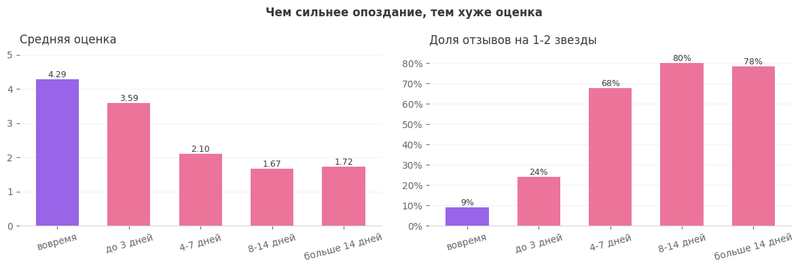
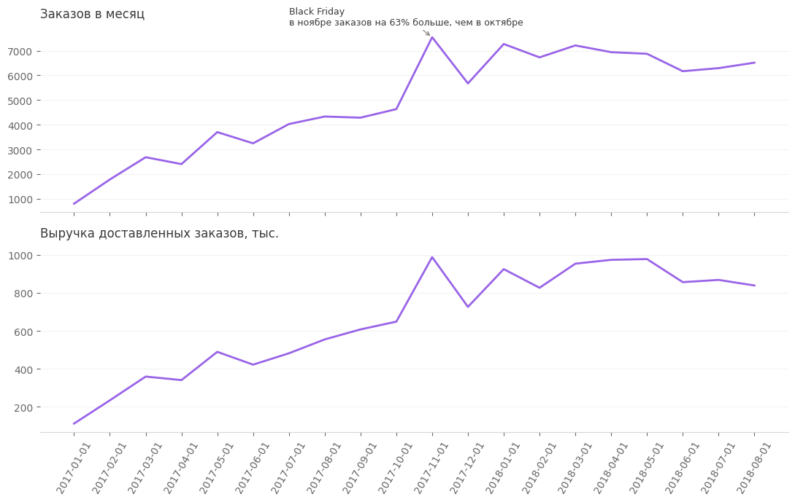
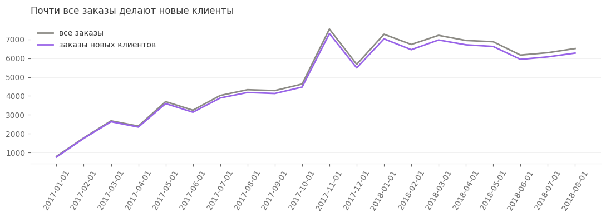
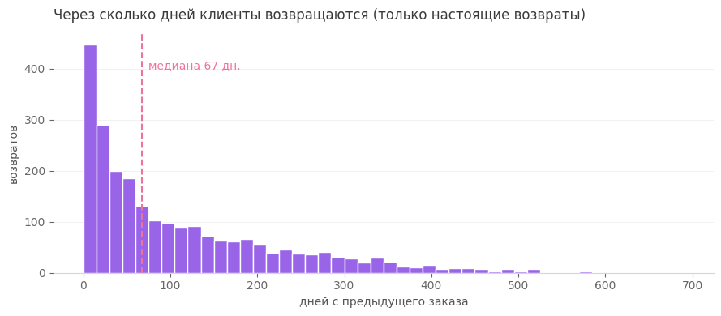
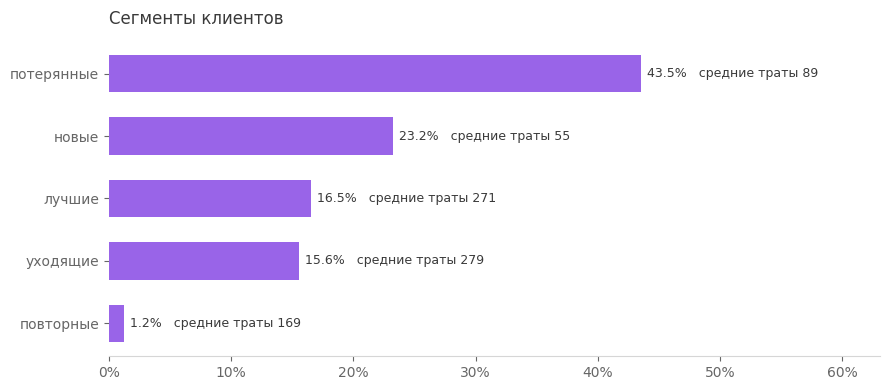
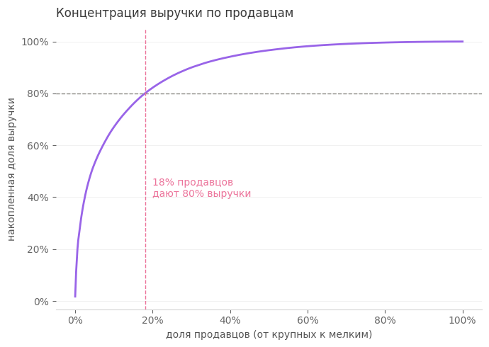

# Olist: анализ бразильского маркетплейса на SQL

Анализ около 100 тысяч заказов маркетплейса Olist за 2016–2018 годы: качество данных, динамика продаж, повторные покупки, влияние доставки на отзывы, RFM-сегментация клиентов и концентрация выручки у продавцов. Все расчёты сделаны в PostgreSQL, графики в Python.

Данные: [Brazilian E-Commerce Public Dataset by Olist](https://www.kaggle.com/datasets/olistbr/brazilian-ecommerce).

## Главное

- **Опоздание доставки — главная причина плохих отзывов.** Если заказ пришёл вовремя, доля оценок 1–2 звезды 9%, а если с опозданием, то 54%. Средняя оценка падает с 4.29 до 2.57. Резкий скачок после 3 дней опоздания: с 24% плохих отзывов до 68%, а после недели около 80%.
- **Клиенты почти не возвращаются.** Только около 2% покупателей сделали вторую покупку в другой день. Почти все заказы каждого месяца делают новые клиенты.
- **Средний чек 138, а медиана 87.** Выше среднего только 29% заказов: среднее тянут вверх редкие дорогие покупки.
- **Кто возвращается, делает это примерно через 2 месяца** (медиана 67 дней). В это окно имеет смысл отправлять напоминания и промокоды.
- **Black Friday 2017 дал +63% заказов к октябрю**, а в декабре спрос просел на 25%.
- **18% продавцов приносят 80% выручки**, маркетплейс сильно зависит от крупных продавцов.



## Что не так с данными

Перед анализом я проверила данные, и это повлияло на все расчёты:

- `customer_id` уникален для каждого заказа, это не клиент. Реальный человек — `customer_unique_id`: 96 096 клиентов на 99 441 заказ. Если считать по `customer_id`, повторных покупателей будет ровно ноль.
- 961 «повторный» заказ сделан в тот же день, что и предыдущий, иногда с разницей в секунды. Похоже, корзину с товарами разных продавцов система разбивает на несколько заказов. Такие заказы я не считаю возвратами, поэтому доля повторных покупателей 2.2%, а не 3.1%.
- У 547 заказов несколько отзывов: заказ пришёл несколькими посылками, клиент изменил оценку или это технический дубль. Беру последний отзыв по дате.
- 775 заказов без товаров (в основном `unavailable` и `canceled`), 8 «доставленных» заказов без даты доставки, 610 товаров без категории.
- В 2016 году данных почти нет, а в сентябре–октябре 2018 выгрузка обрывается. Динамику смотрю на полных месяцах, январь 2017 — август 2018.

## Результаты

### Заказы и выручка


### Повторные покупки



### Сегменты клиентов (RFM)
Давность и сумма покупок разбиты на 5 групп через `NTILE`. Частота сведена к «один заказ / больше», потому что у ~97% клиентов заказ один.



| Сегмент | Что делать |
|---|---|
| лучшие | удерживать, программа лояльности |
| уходящие | вернуть персональным предложением: тратили больше всех |
| новые | подтолкнуть ко второй покупке через 1–2 месяца |
| повторные | беречь, самая редкая группа |
| потерянные | не тратить на них бюджет |

### Продавцы


## Что использовано в SQL

JOIN и проверка размножения строк, CTE, подзапросы, `CASE`, работа с датами (`DATE_TRUNC`, интервалы), оконные функции (`ROW_NUMBER`, `DENSE_RANK`, `LAG`, `NTILE`, накопительные `SUM OVER`), медиана через `PERCENTILE_CONT`, представление-витрина `orders_mart` (одна строка на заказ).

## Структура

```
olist-analysis/
├── sql/
│   ├── 00_orders_mart.sql          # витрина заказов
│   ├── 01_data_quality.sql         # проверка данных
│   ├── 02_revenue_dynamics.sql     # заказы, выручка, средний чек
│   ├── 03_customers_retention.sql  # повторные покупки
│   ├── 04_delivery_reviews.sql     # доставка и отзывы
│   ├── 05_rfm.sql                  # RFM-сегментация
│   └── 06_sellers_pareto.sql       # концентрация выручки
├── notebooks/olist_analysis.ipynb  # запросы из sql/ + графики
├── images/                         # графики для README
└── data/exports/                   # CSV для дашборда (не в git)
```

Каждый запрос в `.sql` файлах помечен строкой `-- name: имя`, и ноутбук вызывает их по имени. SQL хранится в одном месте.

## Как запустить

1. Скачать CSV с Kaggle и загрузить их в PostgreSQL (я загружала через импорт в DBeaver). Таблицы: `orders`, `order_items`, `customers`, `order_reviews`, `products`.
2. Установить зависимости: `pip install -r requirements.txt`.
3. Скопировать `.env.example` в `.env` и вписать пароль от базы.
4. Открыть `notebooks/olist_analysis.ipynb` и выполнить все ячейки.

Стек: PostgreSQL, Python (pandas, SQLAlchemy, matplotlib), Jupyter.
